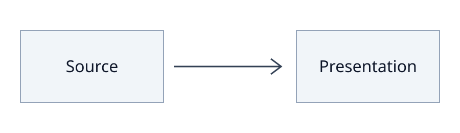

<!-- slide: welcome -->

# Ideas take shape

Write in Markdown, adjust the slide, and draw as you present.

---

<!-- slide: editing -->

# Adjust the page

<div class="pf-slide-grid">
<div class="pf-slide-panel" data-xarp-edit="box">
<h2>Text and layout</h2>
<p data-xarp-edit="text">This panel can move. This sentence can change.</p>
</div>
<div class="pf-slide-panel" data-xarp-edit="box">
<h2>Keep the source</h2>
<p>The saved Markdown carries supported visual edits.</p>
</div>
</div>

---

<!-- slide: mathematics -->

# Mathematics and language

For nonnegative $a$ and $b$, $\sqrt{ab} \leq (a+b)/2$.

<p lang="zh-CN" class="pf-zh-sc">公式和中文可以出现在同页。</p>

```text
source → HTML → presentation
```

---

<!-- slide: drawing -->

# Draw the connection



Annotations stay with each slide during the current page session.
